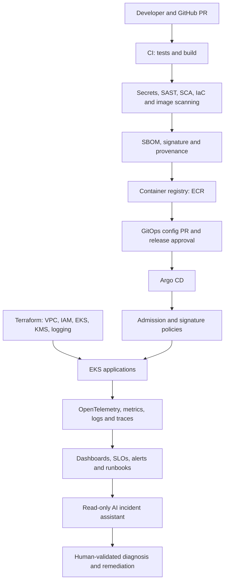

# DevOps, Cloud, DevSecOps, SRE, Platform Engineering & AI Roadmap

> **Personalized 12-month, project-first roadmap | October 2026–September 2027**  
> **Study commitment:** ~15 hours/week (roughly 600–750 hours, depending on pace)  
> **Primary platform:** AWS + Kubernetes + Terraform  
> **Career objective:** Return to hands-on DevOps/Cloud Engineering at a product-based company; grow toward DevSecOps, SRE, Platform Engineering, and secure AI infrastructure.

[Start here](#start-here) · [12-month roadmap](#12-month-roadmap-at-a-glance) · [Detailed monthly plan](#month-1--linux-networking-python-git--troubleshooting) · [Flagship project](#flagship-project-secure-cloud-native-devops-platform) · [Resource library](#curated-course--resource-library) · [Career transition](#career-readiness--job-search-plan) · [Progress tracker](#master-progress-tracker) · [YouTube companion](./YOUTUBE_LEARNING_RESOURCES.md)

---

## 1. Start here

### Personal baseline

| Dimension | Current situation | What this means for the roadmap |
|---|---|---|
| Overall experience | 10+ years in IT | Target experienced technical interviews; do not study solely as a fresher. |
| Earlier position | DevOps-designated role; limited direct hands-on exposure | Refresh practical infrastructure ownership; be honest about the depth of production work. |
| Recent experience | ~4 years in manual QA/testing | Leverage release quality, risk assessment, troubleshooting, and test discipline. |
| Certifications | CKA and CKAD | Skip routine Kubernetes beginner content **when you can pass a skills check**. Verify certification validity if claiming them as current. |
| Current compensation | ₹20–30 LPA CTC | Avoid costly training and junior-role salary resets without a clear reason. |
| Primary goal | Product-company DevOps/Cloud Engineering | Optimize for demonstrable skills, engineering portfolio, and relevant interviews. |

**Central skill gaps:** recent Linux/networking troubleshooting; independent Python/Bash scripting; AWS architecture, IAM, and networking; Terraform engineering; CI/CD and GitOps; production-style Kubernetes operations; cloud/app/supply-chain security; observability and SRE; platform engineering; safe AI integration.

**Core principle:** Use **one primary teacher per topic, one optional supplemental explanation, and an independent project**. Courses are inputs; demonstrated engineering ability is the output. Do not complete overlapping bootcamps just for certificates.

### The recommended provider stack

| Role in learning plan | First choice | Why | Purchase approach |
|---|---|---|---|
| AWS architecture and security fundamentals | [Adrian Cantrill](https://learn.cantrill.io/) | Deeper explanation of design, networking, IAM, resilience, operations | Start with Technical Fundamentals (free) and AWS Solutions Architect Associate; defer advanced courses |
| Guided hands-on labs | [KodeKloud](https://kodekloud.com/learning-paths/) | Terraform, Linux, automation, CI/CD, GitOps, DevSecOps, SRE, AI labs | Begin with monthly access; consider Pro for AWS/cloud playgrounds after checking inclusions |
| Full-stack implementation references | [Abhishek Veeramalla](https://github.com/iam-veeramalla) | AWS, Terraform, Jenkins, Docker, integrated pipelines | Start free with GitHub and [YouTube](https://www.youtube.com/@AbhishekVeeramalla) |
| Shell, Python, debugging | [MIT Missing Semester](https://missing.csail.mit.edu/2026/), [Harvard CS50P](https://cs50.harvard.edu/python/) | Core engineering fluency | Free |
| Realistic repair/troubleshooting drills | [SadServers](https://sadservers.com/scenarios) | Operational problem-solving | Free scenarios initially; paid only if useful |
| Authoritative implementation | [AWS EKS Workshop](https://www.eksworkshop.com/), [HashiCorp Tutorials](https://developer.hashicorp.com/terraform/tutorials), [GitHub Skills](https://skills.github.com/) | Validate best practices and implement current tooling | Usually free content; running AWS resources can cost money |
| DevSecOps and secure coding | [OpenSSF](https://openssf.org/training/), [Kubernetes Goat](https://github.com/madhuakula/kubernetes-goat) | Security controls and safe attack/defense labs | Free; isolated environments only |
| Observability and SRE | [Google SRE](https://sre.google/books/), [Grafana](https://www.youtube.com/@Grafana), [PromLabs](https://promlabs.com/), [OpenTelemetry Demo](https://opentelemetry.io/docs/demo/) | Reliability and operational diagnostics | Free primary resources |
| MLOps and agentic AI | [DataTalks.Club MLOps Zoomcamp](https://github.com/DataTalksClub/mlops-zoomcamp), [Hugging Face Agents](https://huggingface.co/learn/agents-course/en/unit0/introduction) | Deploying AI safely and instrumenting it | Free primary resources |
| Select specialization/alternate courses | [Coursera](https://www.coursera.org/), [Udemy](https://www.udemy.com/), [TechWorld with Nana](https://www.techworld-with-nana.com/) | Fill identified gaps, not repeat the full core | Optional; see [buying strategy](#course-buying--budget-strategy) |
| Specialist troubleshooting & interactive training | [Pluralsight](https://www.pluralsight.com/) | Linux/K8s failure analysis, observability labs, targeted AI security | Optional 1-month sprint or employer access; see [specialist courses](#e-pluralsight--optional-specialist-video-courses-and-labs-2026-update) |
| Specialist engineering videos & reference books | [O'Reilly](https://www.oreilly.com/online-learning/) | SRE, Kubernetes security, observability and software architecture | Optional short subscription or employer access; avoid library overlap |
| Parallel infrastructure/system-design track | [ByteByteGo](https://www.youtube.com/@ByteByteGo), [Hello Interview](https://www.hellointerview.com/learn/system-design/in-a-hurry/introduction) | Architecture and engineering interviews | Free first; optional InfraExpert later |

> **About pricing:** Prices and availability are dynamic, promotional, currency- and tax-dependent. Previous research noted approximate advertised individual prices of **$40** for Adrian Cantrill AWS SAA, **$80** for his AWS DevOps Professional and **$80** for AWS Security Specialty; BossCoder DevOps was advertised near **₹1,61,999**; Nana's premium bootcamps were substantially more expensive than typical Udemy courses. **Verify live checkout and refund terms**; do not use these figures as guaranteed October 2026 prices.

### Expected outcomes

By the end you should be able to:

1. Diagnose Linux, network, DNS, TLS, AWS IAM and Kubernetes failures without blindly copying commands.
2. Design secure, fault-aware AWS infrastructure and provision it reproducibly using tested Terraform modules.
3. Build CI/CD pipelines with automated testing, scanning, signed artifacts, deployment approvals and rollback.
4. Operate a cloud-native application with metrics, logs, traces, alerts, backups, SLOs and incident runbooks.
5. Build DevSecOps controls across identities, IaC, source code, dependencies, containers, Kubernetes and the supply chain.
6. Develop a basic internal developer platform and document operational tradeoffs.
7. Deploy and monitor an AI workload and build a **read-only, human-supervised** incident-assistance prototype.
8. Explain and defend your work in product-company DevOps/Cloud interviews, accurately distinguishing labs from work experience.

### Prioritization rules

- **Must do:** Linux, TCP/IP/DNS/TLS, Python/Bash, Git, AWS/IAM/VPC, Terraform, CI/CD, EKS, Helm/Argo CD, security baseline, observability, incident response.
- **Next:** GitOps scaling, platform templates, advanced AWS operations, sophisticated DevSecOps, SRE exercises.
- **Later specialization:** MLOps, KServe/model serving, AIOps, AI agent security, advanced multi-cloud.
- **Can skip after competency check:** basic kubectl navigation, Kubernetes architecture, pod/controller basics from CKA/CKAD.
- **Do not equate with experience:** laboratory projects ≠ running business-critical production services.

---

## 2. 12-month roadmap at a glance

**Starting month:** October 2026, but shift calendar dates if you start later. Every month uses a four-week loop: **learn → build → secure/debug → demonstrate**.

| Month | Main focus | Core learning source(s) | Evidence/deliverable | Career checkpoint |
|---|---|---|---|---|
| **1** | Linux, Git, networking, Python/Bash, diagnostics | MIT, CS50P, KodeKloud, SadServers, Practical Networking | Tested Linux Operations Toolkit | Baseline assessment |
| **2** | AWS architecture, VPC, DNS, IAM, EC2, S3, resilience | Adrian Cantrill SAA, Abhishek AWS, AWS docs | Secure AWS foundation and architecture notes | Build role shortlist |
| **3** | Terraform, modules, state, testing, Ansible | KodeKloud, HashiCorp, Abhishek | Reusable IaC, test/cleanup scripts | Draft technical resume |
| **4** | Docker, CI/CD, ECR/EKS, Helm, Argo CD | KodeKloud, Abhishek Jenkins, AWS EKS Workshop, GitHub Skills | Fully automated Kubernetes delivery | **Begin targeted DevOps applications** |
| **5** | IAM, KMS, cloud logging, threat modeling, secure coding | Adrian AWS Security, OpenSSF, Coursera IBM | Hardened infrastructure and threat model | Security-focused mock interviews |
| **6** | SAST/DAST/SCA, IaC scanning, SBOM, image signing, admission | KodeKloud DevSecOps, Kubernetes Goat, OWASP, SLSA | Secure supply-chain pipeline | Expand security-aware DevOps search |
| **7** | Prometheus, Grafana, logging, tracing, OpenTelemetry | KodeKloud, PromLabs, Grafana, OTel Demo | Full-stack telemetry and diagnosis | Observability deep dives |
| **8** | SLOs, incidents, backups, resilience, load tests | Google SRE, SadServers, EKS best practices | Tested incident and recovery runbooks | SRE-adjacent roles selectively |
| **9** | Platform Engineering, self-service, GitOps at scale, FinOps | KodeKloud Platform, DevOps Toolkit, Backstage | Self-service app environment template | Platform interview practice |
| **10** | Advanced AWS DevOps, operations automation, AI in workflows | Adrian AWS DevOps Pro, KodeKloud AIOps, Coursera optional | Guardrailed AI-supported ops workflow | System-design interviews |
| **11** | ML/LLM operations, KServe, inference, model monitoring | MLOps Zoomcamp, KodeKloud Cloud-Native AI, DeepLearning.AI | Tested containerized inference application | AI infrastructure roles (stretch) |
| **12** | Secure agents, AIOps evaluation, portfolio consolidation | Hugging Face, OWASP GenAI, KodeKloud | Read-only incident assistant and final demos | Strong portfolio and interview loop |

**Expected time:** ~15 hours/week. 12 × 4 weeks × 15 = 720 planned hours; months vary in length, so use **~600–750 hours** as a flexible guide, not a hard deadline.

### Optional specialist course overlay — Pluralsight + O'Reilly (updated October 2026)

These **replace overlapping videos/labs**, never add another full curriculum. Pick **at most one supplemental paid course per month** after checking whether you can already perform the deliverable.

| Month | Pluralsight (optional paid) | O'Reilly (optional paid) | Keep the primary project |
|---|---|---|---|
| 1 | Linux Diagnostics (EX342); Python scripting only if needed | Linux System Administration Troubleshooting | Linux Operations Toolkit + SadServers |
| 2 | No essential new course | Software Architecture Fundamentals (selected lessons) | Secure AWS VPC and IAM design |
| 3 | Terraform path (state/testing only) | Terraform Essentials for AWS only if weak | Tested Terraform modules |
| 4 | GitHub Actions Deep Dive; Kubernetes Troubleshooting | GitHub Actions in Action (alternative) | CI/CD to EKS via Argo CD |
| 5 | Selected CKS hardening lessons | Kubernetes Security Essentials | IAM, threat model, secure deployment |
| 6 | CKS/runtime security labs | DevSecOps Fundamentals (optional) | Security-gated pipeline, SBOM, signatures |
| 7 | Kubernetes SRE-Grade Observability | OpenTelemetry in Practice (alternative) | Metrics/logs/traces and failure diagnosis |
| 8 | Kubernetes Troubleshooting, if not done | SRE Essentials | SLOs, incidents, DR exercise |
| 9 | Platform Engineering: The Big Picture | Effective Platform Engineering | Self-service internal platform |
| 10 | Applying GenAI to DevOps | SaaS Architecture (architecture supplement) | AI-assisted ops with review gates |
| 11 | AI operations recap | LLM Lifecycle Mastery (optional) | Monitored AI deployment |
| 12 | Agentic AI Security: Tool Interfaces & Least Privilege | AI Engineering videos/reference | Read-only AI incident assistant |

For official course links and priorities, see [Pluralsight videos](#e-pluralsight--optional-specialist-video-courses-and-labs-2026-update) and [O'Reilly videos](#f-oreilly--optional-specialist-videos-and-advanced-reference-books). **Core learning remains Adrian Cantrill + KodeKloud + independent projects.**


---

## 3. Detailed month-by-month plan

> **How to use this section:** Each month has (a) knowledge objectives, (b) primary resources, (c) optional reinforcement, (d) an independent hands-on deliverable, and (e) explicit completion checks. Course pages are starting points; content and exact URLs may change.

### Month 1 — Linux, networking, Python, Git & troubleshooting

**Learn**

- Linux user/group permissions, filesystems, disk and memory, processes, `systemd`, logs, SSH, cron, package management.
- Networking: OSI/TCP-IP, CIDR/subnetting, routing, DNS, HTTP/S, TLS, proxies, ports, NAT, packet flow.
- Bash: functions, conditionals, exit codes, traps, quoting and safe scripting.
- Python: functions, exceptions, file/JSON/YAML handling, HTTP APIs, logging, `pytest`, type hints where useful.
- Git branches, pull requests, merges/rebases, debugging and documentation.

**Study sequence**

1. [MIT Missing Semester 2026](https://missing.csail.mit.edu/2026/): shell, command-line environment, debugging/profiling, Git, packaging and code quality.
2. [KodeKloud DevOps Engineer path](https://kodekloud.com/learning-path/devops-engineer): prerequisite/Linux/Bash/Git labs (selectively).
3. [Harvard CS50 Python](https://cs50.harvard.edu/python/): functions, exceptions, files, libraries, unit tests; skip easy material after demonstrating competence.
4. [Practical Networking YouTube](https://www.youtube.com/@PracticalNetworking) and [Hussein Nasser](https://www.youtube.com/@hnasr): TCP/IP, DNS, TLS, HTTP, systems debugging.
5. [SadServers scenarios](https://sadservers.com/scenarios): 2–3 per week, independently first.

**Build: Linux Operations Toolkit** (`operations-toolkit/`)

- Python CLI that checks service reachability, CPU/memory/disk, sockets/ports and log anomalies; emits JSON and human-readable output.
- Bash scripts for service checks with meaningful exit codes.
- `pytest` tests, error handling, logging, README and example output.
- Record exact commands and reasoning for at least **six** Linux/network incidents.

**Done when**

- [ ] Diagnose a failed `systemd` service with `journalctl`, `ss`, `ps`, logs and resource observations.
- [ ] Explain a DNS/TLS/route issue using `dig`, `curl`, `traceroute`/`tracepath` and packet/connection reasoning.
- [ ] Run a tested Python automation script without following video steps.
- [ ] Solve ≥6 SadServers exercises and write concise troubleshooting notes.

### Month 2 — AWS architecture, networking and IAM

**Learn**

- AWS account design and billing, IAM/STS, policies, identity federation, least privilege, KMS and secrets.
- VPC, public/private subnets, CIDR, route tables, NAT/IGW, SG vs NACL, DNS, endpoints and load balancers.
- EC2, Auto Scaling, S3, EBS, RDS concepts, high availability, backups and recovery.
- CloudTrail, CloudWatch, tagging, budget alerts, cost visibility and shared-responsibility model.

**Study sequence**

1. [Adrian Cantrill — Technical Fundamentals](https://learn.cantrill.io/p/tech-fundamentals) (free; networking/DNS/encryption refresh).
2. [Adrian Cantrill — AWS Solutions Architect Associate](https://learn.cantrill.io/p/aws-certified-solutions-architect-associate-saa-c03), focus on architecture and demos rather than rushing certification.
3. [Abhishek — AWS DevOps Zero to Hero](https://github.com/iam-veeramalla/aws-devops-zero-to-hero), use labs as reinforcement.
4. [AWS Workshops](https://workshops.aws/) and [AWS Well-Architected Framework](https://docs.aws.amazon.com/wellarchitected/latest/framework/welcome.html).

**Build: Secure AWS Foundation** (`infrastructure/aws-foundation/`)

- Sandbox AWS account with MFA, guardrails, billing alerts and clear naming/tags.
- VPC with segmented subnets, test compute, least-privilege IAM, logging and encrypted storage.
- Architecture diagram, threat notes, traffic-flow explanation and recovery/cleanup instructions.
- Start manually for conceptual clarity; migrate the environment to Terraform in Month 3.

**Done when**

- [ ] Explain VPC routing, internet egress, private access, DNS and TLS.
- [ ] Debug a simulated `AccessDenied` error using actual IAM policy evaluation.
- [ ] Explain and demonstrate encryption, audit logs and a basic backup/restore exercise.
- [ ] Delete chargeable resources and confirm billing/resource cleanup.

### Month 3 — Terraform, IaC engineering and configuration management

**Learn**

- Terraform provider lifecycle, modules, inputs/outputs, data sources, dependencies, state/locking, remote backends, import/move, drift.
- IaC code review, formatting, validation, tests, security scanning and separation of accounts/environments.
- Ansible inventory, idempotent playbooks, roles and config-management boundaries.

**Study sequence**

1. [KodeKloud Terraform courses](https://kodekloud.com/learning-paths/) and hands-on labs.
2. [HashiCorp Terraform Tutorials](https://developer.hashicorp.com/terraform/tutorials), especially modules, state, tests and collaboration.
3. [Abhishek — Terraform Zero to Hero](https://github.com/iam-veeramalla/terraform-zero-to-hero).
4. [KodeKloud Ansible](https://kodekloud.com/learning-paths/) selectively.
5. Optional if needed: [Zeal Vora — Terraform (Udemy)](https://www.udemy.com/course/terraform-beginner-to-advanced/).

**Build: Reusable AWS Terraform Modules** (`infrastructure/terraform/`)

- Modules for network, IAM, compute (and later EKS); descriptive variables and outputs.
- Protected remote state with encryption, appropriate access restrictions and locking where supported.
- CI to run `terraform fmt`, `validate`, static/security checks and selected tests.
- Demonstrate safe handling of changes, drift and teardown; include resource cost estimates.

**Done when**

- [ ] Provision, modify and destroy a sandbox from code.
- [ ] Explain why state is sensitive, how it is protected and how concurrent changes are controlled.
- [ ] Catch a deliberately insecure IaC change in PR checks.
- [ ] Demonstrate a reproducible rebuild and document costs.

### Month 4 — Docker, CI/CD, EKS, Helm and GitOps

**Learn**

- Image layers, multi-stage builds, non-root execution, tagging/immutability, ECR and image lifecycle.
- GitHub Actions or Jenkins: test/build/scan/publish, reusable workflows, secrets, OIDC federation, approvals and runners.
- EKS fundamentals beyond CKA/CKAD: networking, managed node groups, autoscaling, IAM for workloads, ingress, storage, logging.
- Helm release workflows, Argo CD reconciliation, environment promotion, rollback and drift detection.

**Study sequence**

1. [KodeKloud DevOps Engineer learning path](https://kodekloud.com/learning-path/devops-engineer): Jenkins/CI/CD/Docker/Helm/Argo CD.
2. [Abhishek — Jenkins Zero to Hero](https://github.com/iam-veeramalla/Jenkins-Zero-To-Hero).
3. [AWS EKS Workshop](https://www.eksworkshop.com/): automation, security, networking, scaling.
4. [GitHub Skills](https://skills.github.com/) and [GitHub Actions documentation](https://docs.github.com/en/actions).
5. Optional implementation reference: [Abhishek — Ultimate DevOps Project (Udemy)](https://www.udemy.com/course/ultimate-devops-project-with-resume-preparation/).

**Build: Automated EKS Application Delivery** (`app/`, `pipelines/`, `kubernetes/`)

- Deploy [Google Online Boutique](https://github.com/GoogleCloudPlatform/microservices-demo) or a similar microservices app.
- PR → tests → security checks → Docker image → ECR → GitOps config PR → approval → Argo CD → EKS.
- Separate application build and infrastructure changes; implement probes, resource limits, rollout/rollback and deployment evidence.
- Use a *local* Kubernetes cluster for routine iteration; bring up EKS for AWS-specific tasks, then destroy it.

**Done when**

- [ ] A reviewed commit follows an automated, traceable delivery pipeline.
- [ ] Failed tests/scans prevent promotion; a broken release is recoverable.
- [ ] Explain identity/secret handling in CI and workload authentication to AWS.
- [ ] Can independently diagnose a failed image pull, readiness probe, rollout or network connection.

**Career action:** Begin applications to suitable DevOps Engineer, Cloud Automation Engineer, CI/CD Engineer and Release Engineer roles. Do not wait until Month 12 if phase competencies are demonstrated.

### Month 5 — Secure AWS architecture and secure development

**Learn**

- IAM policy evaluation, temporary credentials, federated identities, workload roles, KMS, Secrets Manager, CloudTrail, Config and GuardDuty.
- Threat modeling, asset inventories, risk prioritization, secure defaults, encryption in transit/at rest, logging and incident-readiness.
- Secure development practices and OWASP application vulnerabilities relevant to pipelines and infrastructure.

**Study sequence**

1. [Adrian Cantrill catalog — AWS Security Specialty](https://learn.cantrill.io/) (selected topics; advanced optional paid course).
2. [OpenSSF — Developing Secure Software](https://openssf.org/training/) (LFD121).
3. [Coursera/IBM — Application Security for Developers and DevOps Professionals](https://www.coursera.org/learn/application-security-for-developers-devops) (optional targeted supplement).
4. [AWS Security Best Practices](https://docs.aws.amazon.com/security/).
5. [NIST Secure Software Development Framework](https://csrc.nist.gov/pubs/sp/800/218/final).

**Build: Harden the AWS Foundation** (`security/threat-models/`, `security/policies/`)

- Threat model for CI → AWS → Kubernetes data flows.
- Least-privilege identities, key/secrets handling, audit logging, encryption and network restrictions.
- Remove excessive permissions and document before/after evidence.
- Explain operational access and audit requirements (including break-glass process in concept, not production shortcuts).

**Done when**

- [ ] Threat model contains assets, trust boundaries, plausible threats and countermeasures.
- [ ] Can demonstrate a denied unauthorized action and trace relevant logs.
- [ ] No long-lived AWS keys in code, Git or pipeline configuration.
- [ ] Security design documented with explicit residual risks.

### Month 6 — DevSecOps and software supply-chain security

**Learn**

- Secret detection, SAST, DAST, SCA, SBOM, vulnerability triage, infrastructure scanning and policy as code.
- Artifact integrity, image signing and provenance; GitHub OIDC, environment protection and deployment authorization.
- Kubernetes security: RBAC, pod security, admission policies, NetworkPolicy, runtime detection, image policy.
- Safe vulnerability labs, response, and documentation of exceptions/false positives.

**Study sequence**

1. [KodeKloud DevSecOps path/courses](https://kodekloud.com/learning-paths/) and selected Kubernetes security/CKS labs.
2. [Kubernetes Goat](https://github.com/madhuakula/kubernetes-goat) in disposable isolated clusters only.
3. [OpenSSF training](https://openssf.org/training/) and [SLSA specification](https://slsa.dev/spec/v1.2/).
4. [OWASP resources](https://owasp.org/) and [NIST SSDF](https://csrc.nist.gov/pubs/sp/800/218/final).
5. **Optional alternate premium track:** [TechWorld with Nana DevSecOps Bootcamp](https://www.techworld-with-nana.com/devsecops-bootcamp). Choose *instead of*, not automatically in addition to, the assembled sequence.

**Build: Secure Software Delivery Pipeline** (`security/scanning/`, `security/policies/`)

- Gitleaks (secrets); Semgrep/CodeQL/SonarQube (SAST); Dependabot/other SCA; Trivy (container); Checkov/tfsec (IaC); OWASP ZAP (controlled DAST).
- Syft SBOM; Cosign image signature, provenance and verification; use supported admission policies (Kyverno or equivalent).
- Document which checks fail PRs, block release, warn only, or require approval; investigate findings.
- Implement a policy/approval gate with clear remediation and exception workflow.

**Done when**

- [ ] A test-only secret, vulnerable dependency or insecure Terraform change is detected without using real secrets.
- [ ] An unsigned/untrusted artifact fails the defined deployment policy.
- [ ] Scans run automatically and reports are visible to reviewers.
- [ ] Document threat, finding, remediation, test and false-positive policy.

### Month 7 — Metrics, logs, tracing and observability

**Learn**

- Golden signals, RED/USE methods, Prometheus exposition and PromQL, Grafana dashboards/alerts.
- Structured logging, correlation IDs, OpenTelemetry instrumentation/collector, traces and sampling.
- CloudWatch and EKS logs/metrics; actionable vs noisy alerts.

**Study sequence**

1. [KodeKloud observability/Prometheus courses](https://kodekloud.com/learning-paths/).
2. [PromLabs](https://promlabs.com/) for PromQL and instrumentation.
3. [Grafana Labs YouTube](https://www.youtube.com/@Grafana) for Loki, Tempo, Alloy and Grafana.
4. [OpenTelemetry Astronomy Shop Demo](https://opentelemetry.io/docs/demo/).
5. [OpenTelemetry documentation](https://opentelemetry.io/docs/).

**Build: Full-Stack Observability** (`observability/`)

- Instrument the sample services or deploy the OTel Demo in a separate, reproducible environment.
- Collect meaningful metrics, application logs and distributed traces; create dashboards and actionable alerts.
- Simulate elevated latency, errors, saturation and a failed dependency; explain evidence from telemetry.

**Done when**

- [ ] Can trace an incoming request across services.
- [ ] Alerts trigger on a user-impacting symptom, not just arbitrary CPU thresholds.
- [ ] Diagnose at least three controlled failures and write concise investigations.
- [ ] Explain label cardinality, alert noise and observability cost implications.

### Month 8 — SRE, reliability, incident response and recovery

**Learn**

- Service level indicators/objectives, error budgets, capacity, load testing, graceful degradation and reliability tradeoffs.
- Backup/restore, RTO/RPO, runbooks, change management, incident communications and blameless postmortems.
- EKS scaling, pod disruption budgets, health checks, rollout failure analysis and operational security.

**Study sequence**

1. [Google SRE Books](https://sre.google/books/): *SRE*, *The SRE Workbook*, *Building Secure & Reliable Systems*.
2. [AWS EKS Best Practices](https://docs.aws.amazon.com/eks/latest/best-practices/).
3. [SadServers](https://sadservers.com/scenarios): intermediate/advanced repair scenarios.
4. [KodeKloud SRE path](https://kodekloud.com/learning-paths/) or a selected [Google Cloud SRE Coursera path](https://www.coursera.org/professional-certificates/sre-devops-engineer-google-cloud) if GCP is strategically relevant.

**Build: Reliability and Incident Response Exercise** (`docs/incidents/`, `docs/runbooks/`)

- Define one availability SLI and an appropriate test-environment SLO; instrument error rate/latency and test an alert.
- Run load, bad-release, dependency-failure and resource-pressure drills.
- Perform backup restoration, measure RTO/RPO in the lab and document constraints.
- Conduct a structured retrospective including timeline, impact, remediation and recurrence prevention.

**Done when**

- [ ] Show measured detection/recovery data from ≥3 independent incident drills.
- [ ] Demonstrate rollback and backup restore, not just explain them.
- [ ] SLOs have a clear numerator/denominator or equivalent precise definition.
- [ ] Runbooks can be followed by someone else.

### Month 9 — Platform Engineering, self-service and FinOps

**Learn**

- Platform API vs scripts, templates, golden paths, developer experience, RBAC/multi-tenancy, Backstage basics.
- GitOps at scale, infrastructure module catalogs, policy guardrails, secrets and environment lifecycle.
- FinOps: tags, cost attribution, budgets, right-sizing, usage monitoring and cleanup automation.

**Study sequence**

1. [KodeKloud Platform Engineer path](https://kodekloud.com/learning-paths/).
2. [Viktor Farcic — DevOps & AI Toolkit](https://www.youtube.com/@DevOpsToolkit) for Crossplane, GitOps and platforms.
3. [Backstage docs](https://backstage.io/docs/) and [HashiCorp tutorials](https://developer.hashicorp.com/terraform/tutorials).
4. [FinOps Framework](https://www.finops.org/framework/).

**Build: Internal Developer Platform Prototype** (`platform/`)

- Template to create a new application environment using approved Terraform, Helm, GitOps and policies.
- Human-readable inputs, service documentation, access controls, environment TTL/cleanup and cost labels.
- Optional Backstage portal; CLI/template workflow is acceptable if it is fully usable and documented.

**Done when**

- [ ] Another engineer can create and delete an environment using the documentation.
- [ ] Security and cost guardrails are enabled by default.
- [ ] Changes are traceable and reversible.
- [ ] Demonstrate a developer experience improvement with a measurable before/after comparison.

### Month 10 — Advanced AWS DevOps and AI-assisted operations

**Learn**

- Advanced AWS monitoring, automated operations, resilient release strategies, account governance and architecture tradeoffs.
- Guardrailed AI for log/pipeline summarization, IaC review, runbook generation and incident hypotheses.
- Limits of LLMs: hallucinations, missing context, prompt injection, secrets leakage, unauthorized actions and auditability.

**Study sequence**

1. [Adrian Cantrill — AWS DevOps Engineer Professional](https://learn.cantrill.io/p/aws-certified-devops-engineer-professional).
2. [KodeKloud AIOps/AI paths](https://kodekloud.com/learning-paths/) (select modules relevant to operations).
3. [Viktor Farcic YouTube](https://www.youtube.com/@DevOpsToolkit).
4. Optional: [Coursera — GenAI for DevOps Practitioners](https://www.coursera.org/learn/genai-for-devops-practitioners).
5. [AWS Well-Architected](https://docs.aws.amazon.com/wellarchitected/latest/framework/welcome.html) for design review.

**Build: Guardrailed Operations Helper** (`ai-operations/`)

- Read-only tool that ingests **sanitized** test logs, CI failures, Terraform plan summaries and operational metrics.
- Suggests possible causes and runbooks with linked supporting evidence.
- Evaluates wrong/unhelpful suggestions; no autonomous production mutations.

**Done when**

- [ ] AI output always includes traceable evidence or states uncertainty.
- [ ] Redaction and access checks prevent sensitive data exposure.
- [ ] Correct/incorrect scenarios are tested and scored.
- [ ] All infrastructure-changing actions are out of scope or require explicit human approval.

### Month 11 — MLOps, AI workload delivery and model operations

**Learn**

- ML experiment/model versioning and reproducibility; datasets, containers, inference APIs, evaluation and deployment.
- KServe or comparable Kubernetes inference serving, runtime isolation, autoscaling and observability.
- GPU/accelerator tradeoffs conceptually, latency, throughput, resource/cost guardrails.
- CI/CD for model/application changes, vulnerability screening and rollback.

**Study sequence**

1. [DataTalks.Club MLOps Zoomcamp](https://github.com/DataTalksClub/mlops-zoomcamp) (self-paced; Python/Docker/basic ML prerequisites).
2. [KodeKloud Kubernetes & Cloud-Native AI](https://kodekloud.com/learning-paths/).
3. [DeepLearning.AI — LLMOps](https://www.deeplearning.ai/courses/llmops/) (optional concise supplement).
4. Optional: [Coursera — DevOps and AI on AWS](https://www.coursera.org/learn/cicd-generative-ai-apps).
5. [KServe documentation](https://kserve.github.io/website/) for model-serving design.

**Build: Production-Style Inference Delivery** (`mlops/`)

- Small containerized inference application with versioned model/artifact, tests, deployment pipeline and monitoring.
- Demonstrate canary or controlled version promotion, rollback and evaluation checks.
- Set resource limits and cost measurements; avoid expensive GPU dependencies when a CPU-sized model suffices.

**Done when**

- [ ] New model/app version can be validated, deployed, monitored and rolled back.
- [ ] Health, latency, error and model-quality indicators are observable.
- [ ] IAM/secret access, network boundaries and artifact integrity are documented.
- [ ] Can explain how MLOps differs from conventional DevOps.

### Month 12 — Secure AIOps agent, portfolio, technical interviews

**Learn**

- LLM agent tools, retrieval and runbook grounding, tool boundaries, prompt-injection defenses, human approvals.
- Secure data handling, permissions, evaluations, refusal/error behavior and cost/latency monitoring.
- Technical interviewing: AWS/IAM/networking, Terraform, CI/CD, EKS, security, SRE and design tradeoffs.

**Study sequence**

1. [Hugging Face Agents Course](https://huggingface.co/learn/agents-course/en/unit0/introduction).
2. [OWASP GenAI Security Project](https://genai.owasp.org/) including LLM and agentic risks.
3. [KodeKloud AI and interview modules](https://kodekloud.com/learning-paths/) (selected).
4. [OpenTelemetry](https://opentelemetry.io/docs/) and [Google SRE books](https://sre.google/books/) to strengthen grounded operations.

**Build: Secure AI-Assisted Incident Investigation** (`ai-operations/assistant/`)

- Read-only assistant that searches sanitized Kubernetes events, alerts, logs and approved runbooks.
- Evidence-backed probable causes, alternative hypotheses, confidence/limitations and links to supporting telemetry.
- Adversarial tests for malicious instructions in retrieved logs, unauthorized operations, data leaks and fabricated root causes.
- Document evaluation set, false-positive/false-negative examples, permission architecture and approximate cost.

**Done when**

- [ ] Can reproduce working demos of the entire platform from documented steps.
- [ ] AI agent cannot mutate infrastructure without a separate, explicit controlled approval design.
- [ ] Portfolio contains architecture diagrams, ADRs, runbooks, security findings, postmortems, tests and demo videos/screenshots.
- [ ] Prepared to discuss ≥5 incidents/failures and explain tradeoffs in a technical interview.

---

## 4. First 30 days — weekly task checklist

### Week 1 — Linux & shell

- [ ] Complete MIT shell and command-line environment lectures.
- [ ] Perform KodeKloud Linux labs on permissions, processes, services and SSH.
- [ ] Solve 2 SadServers Linux scenarios.
- [ ] Set up a Git repository, notes, scripts and shell automation folder.

### Week 2 — Networking & Git

- [ ] Study DNS, TCP/IP, routing and TLS with Practical Networking.
- [ ] Complete MIT Git and debugging lectures.
- [ ] Investigate mock failures with `dig`, `curl`, `ss`, `openssl s_client` and `tracepath` where available.
- [ ] Record 2 troubleshooting case studies.

### Week 3 — Python & Bash

- [ ] Work through CS50P functions, exceptions and files as required.
- [ ] Write a Python service/endpoint health-check CLI.
- [ ] Add `pytest`, structured logging and failure handling.
- [ ] Write a Bash script that detects/reports an unhealthy service with nonzero exit codes.

### Week 4 — Demonstrate

- [ ] Complete the Linux Operations Toolkit, README and sample output.
- [ ] Add tests and GitHub Actions for linting/test execution.
- [ ] Solve ≥2 further SadServers scenarios independently.
- [ ] Review gaps and start Cantrill AWS Technical Fundamentals/SAA.

---

## 5. Flagship project: Secure Cloud-Native DevOps Platform

**Goal:** Build **one evolving portfolio**, not 12 disconnected tutorial copies. The same application gains production-style features each month. The lab models enterprise engineering practices; it does not represent paid production experience.

### Reference architecture



### Suggested repository layout

```text
cloud-devops-platform/
├── app/                         # Sample services and tests
├── infrastructure/
│   ├── terraform/               # Reusable AWS infrastructure modules
│   └── ansible/                 # Configuration management exercises
├── pipelines/                   # CI/CD workflows and automation
├── kubernetes/
│   ├── base/
│   ├── helm/
│   └── gitops/
├── security/
│   ├── scanning/
│   ├── policies/
│   └── threat-models/
├── observability/
│   ├── dashboards/
│   ├── alerts/
│   └── telemetry/
├── platform/                    # Golden paths and self-service templates
├── mlops/                       # Versioned model/inference app
├── ai-operations/
│   ├── assistant/
│   └── evaluations/
├── tests/
├── docs/
│   ├── architecture/
│   ├── decisions/
│   ├── runbooks/
│   └── incidents/
└── README.md
```

### Production-style definition of done

- [ ] **Infrastructure:** Terraform is modular, validated and testable; state is protected; changes are reviewed and environments can be destroyed cleanly.
- [ ] **Network/identity:** Documented traffic boundaries; least-privilege policies, temporary identities and proper secret handling.
- [ ] **Supply chain:** Artifact versioning, SBOM, relevant scans and verification of signatures/provenance where implemented.
- [ ] **CI/CD:** Tests and policy checks gate changes; approvals separate build from deployment; releases can be rolled back.
- [ ] **Application:** Readiness/liveness checks, defined resources, graceful shutdown, secure configuration and dependency management.
- [ ] **Kubernetes:** Admission guardrails, policy/RBAC, workload IAM, network isolation and tested rollout behavior.
- [ ] **Observability:** Useful metrics, structured logs, traces, dashboards and alerts tied to symptoms.
- [ ] **Reliability:** SLOs, load tests, rehearsed rollback, backup restoration and recovery measurements.
- [ ] **Security:** Threat model, findings/remediation history, risk exceptions and testing evidence.
- [ ] **Platform:** A documented developer self-service path with reasonable defaults and resource cleanup.
- [ ] **Cost:** Tagged resources, usage tracking, budgets, teardown and avoided idle cloud services.
- [ ] **AI:** Sanitized data, permission constraints, traceable output, eval cases, refusal behavior and human supervision.
- [ ] **Documentation:** A new engineer can reproduce the lab, reason about architecture and follow runbooks.

### Mandatory capstone acceptance tests

1. Provision and teardown infrastructure by documented automation.
2. Cause a test to fail and verify CI blocks release.
3. Add a *fake/test-only* secret and verify secret scanning flags it.
4. Attempt to deploy a deliberately unsigned/untrusted image and confirm policy blocks it.
5. Trigger a failed rollout and execute a successful rollback.
6. Load-test the app and observe measured resource/latency trends and expected scaling behavior.
7. Restore backup data and record observed recovery time.
8. Investigate a failed dependency with metrics/logs/traces; publish a blameless postmortem.
9. Feed a prompt-injection attempt embedded in test logs to the AI assistant; verify that it is treated as untrusted data.
10. Rebuild or review the environment through documentation and confirm clean resource removal.

> **Safety:** Use isolated local/cloud sandboxes. Never attack third-party systems, deploy intentionally vulnerable labs publicly, paste proprietary data into external AI tools, or run destructive tests in employer/production environments without authorization.

---

## 6. Weekly study system

### Suggested 15-hour allocation

| Activity | Hours/week | Purpose |
|---|---:|---|
| Independent hands-on implementation | **7** | Build without copying videos |
| Courses, reading and note-taking | **4** | Establish concepts |
| Troubleshooting, failure injection and drills | **2** | Develop operational judgment |
| Documentation, retrospective and interview explanation | **2** | Produce career-relevant evidence |
| **Total** | **15** | |

| Day | Assignment | Time |
|---|---|---:|
| Monday | Primary course + notes | 1.5 h |
| Tuesday | Hands-on labs | 2 h |
| Wednesday | Primary course + focused exercises | 1.5 h |
| Thursday | Independent capstone work | 2 h |
| Friday | SadServers / debugging drills | 1.5 h |
| Saturday | Build, test, secure and recover project | 4 h |
| Sunday | Documentation, review, mock-interview explanation | 2.5 h |

**Four-week monthly cycle:**

- **Week 1 — Understand:** Concepts, prerequisites, small labs.
- **Week 2 — Build:** Implement the core project independently.
- **Week 3 — Secure & break:** Security controls, failure simulations, observability, remediation.
- **Week 4 — Demonstrate:** Rebuild from docs, run acceptance tests, explain design tradeoffs and update portfolio.

**Do not advance solely because four weeks elapsed.** If the exit criteria are unmet, extend that phase and preserve quality.

---

## 7. Curated course & resource library

Below is the **full consolidated inventory** from the earlier comparisons. Items marked *optional* are alternatives, not extra required coursework. Prefer current official documentation if a tutorial demonstrates deprecated practices.

### A. Primary paid/structured providers

**Adrian Cantrill — AWS deep dive** — [Catalog](https://learn.cantrill.io/)

- [Technical Fundamentals](https://learn.cantrill.io/p/tech-fundamentals) — free; Linux/network/DNS/security refresh.
- [AWS Solutions Architect Associate (SAA-C03)](https://learn.cantrill.io/p/aws-certified-solutions-architect-associate-saa-c03) — foundational AWS architecture (Months 1–3).
- [AWS DevOps Engineer Professional](https://learn.cantrill.io/p/aws-certified-devops-engineer-professional) — advanced AWS automation/operations (Months 9–10).
- [AWS Security Specialty](https://learn.cantrill.io/) — optional deeper cloud security (Months 5–6 or later).
- [AWS Solutions Architect Professional](https://learn.cantrill.io/) — optional advanced architecture beyond core.
- [AWS Advanced Networking Specialty](https://learn.cantrill.io/) — optional if specializing in networking.

**KodeKloud — primary lab platform** — [Learning paths](https://kodekloud.com/learning-paths/) · [DevOps path](https://kodekloud.com/learning-path/devops-engineer) · [Pricing](https://kodekloud.com/pricing/)

- DevOps Prerequisite, Linux, Bash, Git, Python/YAML.
- Terraform for Beginners, IaC path, Terraform modules/testing.
- Ansible for Beginners.
- Jenkins, GitHub Actions, CI/CD path; Docker and Helm refresh.
- GitOps with Argo CD; cloud AWS playgrounds and EKS.
- Prometheus and Observability labs; SRE path.
- DevSecOps/Kubernetes Security/CKS topics; Platform Engineer path.
- AIOps and Kubernetes & Cloud-Native AI paths (KServe, AI troubleshooting tools).
- DevOps Interview Preparation modules.

**TechWorld with Nana — premium alternative and free explanations** — [YouTube](https://www.youtube.com/@TechWorldwithNana)

- [DevOps Bootcamp](https://www.techworld-with-nana.com/devops-bootcamp) — structured full DevOps journey; **optional alternative** to assembling Cantrill/KodeKloud.
- [DevSecOps Bootcamp](https://www.techworld-with-nana.com/devsecops-bootcamp) — advanced integrated security curriculum; **optional alternative** to selected DevSecOps courses; ensure prerequisites.
- Free YouTube material: Kubernetes, Docker, Helm, Terraform, CI/CD and cloud-native explanation.

**Coursera — selective courses** — [Catalog](https://www.coursera.org/)

- [AWS Cloud Solutions Architect Professional Certificate](https://www.coursera.org/professional-certificates/aws-cloud-solutions-architect) — **optional alternative** to Cantrill AWS SAA, not mandatory together.
- [IBM Applied DevOps Engineering Professional Certificate](https://www.coursera.org/professional-certificates/ibm-applied-devops-engineering) — **optional alternative** structured DevOps path.
- [IBM DevOps and Software Engineering Professional Certificate](https://www.coursera.org/professional-certificates/devops-and-software-engineering) — introductory and extensive; likely overlapping for this learner.
- [IBM — Application Security for Developers and DevOps Professionals](https://www.coursera.org/learn/application-security-for-developers-devops) — recommended selective security supplement.
- [Google Cloud — Reliable Cloud Infrastructure: Design and Process](https://www.coursera.org/learn/cloud-infrastructure-design-process) — reliability architecture elective.
- [Google Cloud DevOps/SRE Professional Certificate](https://www.coursera.org/professional-certificates/sre-devops-engineer-google-cloud) — if choosing GCP/SRE specialization.
- [GenAI for DevOps Practitioners](https://www.coursera.org/learn/genai-for-devops-practitioners) — optional AI-assisted automation.
- [DevOps and AI on AWS: CI/CD for Generative AI Applications](https://www.coursera.org/learn/cicd-generative-ai-apps) — optional model/app delivery specialization.
- [Coursera Plus](https://www.coursera.org/courseraplus) — check whether target courses are included and local cost before subscribing.

**Udemy — selective inexpensive supplements (not mandatory)**

- [Imran Teli — Decoding DevOps](https://www.udemy.com/course/decodingdevops/) — comprehensive refresher if your foundations are weak.
- [Imran Teli — Real-Time DevOps & GitOps Projects](https://www.udemy.com/course/devopsprojects/) — guided projects; independently validate patterns.
- [Zeal Vora — Terraform Associate](https://www.udemy.com/course/terraform-beginner-to-advanced/) — Terraform weakness-specific reinforcement.
- [Abhishek Veeramalla — Ultimate DevOps Project Implementation](https://www.udemy.com/course/ultimate-devops-project-with-resume-preparation/) — integrated project with interview/resume material.
- [Shikhar Verma — Hands-on DevSecOps (Jenkins/AWS)](https://www.udemy.com/course/devsecops-with-sast-sca-dast/) — optional focused security practice.

**BossCoder / Scaler — placement-oriented alternatives, not part of core learning stack**

- [BossCoder DevOps](https://www.bosscoderacademy.com/devops-course) — consider only if *verified* mentoring/interview introductions meaningfully address your specific return-to-DevOps gap.
- [Scaler DevOps](https://www.scaler.com/devops-course/) — higher-cost structured alternative; demand evidence of value for professionals with 10+ years in IT and ₹20–30 LPA current salary.
- Do **not** treat general institute placement percentages as DevOps-specific outcomes. Ask for recent comparable alumni, role/CTC evidence, eligibility, program-specific contractual placement and refund conditions.

### B. Free/open official courses, projects and references

| Resource | Link | Best use |
|---|---|---|
| MIT Missing Semester 2026 | https://missing.csail.mit.edu/2026/ | Shell, tools, Git, debugging |
| Harvard CS50 Python | https://cs50.harvard.edu/python/ | Tested automation coding |
| SadServers | https://sadservers.com/scenarios | Linux/DevOps repair practice |
| Practical Networking | https://www.youtube.com/@PracticalNetworking | Networking fundamentals |
| AWS Workshops | https://workshops.aws/ | AWS implementations |
| AWS EKS Workshop | https://www.eksworkshop.com/ | EKS operations and design |
| AWS EKS Best Practices | https://docs.aws.amazon.com/eks/latest/best-practices/ | Production engineering patterns |
| AWS Well-Architected | https://docs.aws.amazon.com/wellarchitected/latest/framework/welcome.html | Architecture tradeoffs |
| Terraform tutorials | https://developer.hashicorp.com/terraform/tutorials | IaC practices and tests |
| GitHub Skills | https://skills.github.com/ | CI/CD and collaborative workflows |
| OpenSSF training | https://openssf.org/training/ | Secure software practices |
| Kubernetes Goat | https://github.com/madhuakula/kubernetes-goat | Isolated security exercises |
| NIST SSDF | https://csrc.nist.gov/pubs/sp/800/218/final | Secure SDLC reference |
| SLSA v1.2 | https://slsa.dev/spec/v1.2/ | Supply-chain integrity |
| OWASP | https://owasp.org/ | Application security |
| OWASP GenAI Security | https://genai.owasp.org/ | LLM and agent security |
| Google SRE Books | https://sre.google/books/ | Incidents, SLOs, reliability |
| OpenTelemetry Docs | https://opentelemetry.io/docs/ | Observability instrumentation |
| OpenTelemetry Demo | https://opentelemetry.io/docs/demo/ | Microservices instrumentation |
| PromLabs | https://promlabs.com/ | Prometheus/PromQL |
| Grafana Labs | https://www.youtube.com/@Grafana | Logs, traces, dashboards |
| Backstage | https://backstage.io/docs/ | Developer portals |
| FinOps Framework | https://www.finops.org/framework/ | Cloud cost controls |
| Google Online Boutique | https://github.com/GoogleCloudPlatform/microservices-demo | Capstone application |
| MLOps Zoomcamp | https://github.com/DataTalksClub/mlops-zoomcamp | ML lifecycle and production delivery |
| Hugging Face Agents | https://huggingface.co/learn/agents-course/en/unit0/introduction | Agents and tool workflows |
| KServe | https://kserve.github.io/website/ | Kubernetes inference serving |
| DeepLearning.AI LLMOps | https://www.deeplearning.ai/courses/llmops/ | Short LLM operations introduction |

### C. Curated YouTube channels

A detailed month-by-month channel and video guide is maintained separately in [YOUTUBE_LEARNING_RESOURCES.md](./YOUTUBE_LEARNING_RESOURCES.md). The entries below are a concise directory.

| Channel | Link | Focus |
|---|---|---|
| Abhishek Veeramalla | https://www.youtube.com/@AbhishekVeeramalla | AWS, CI/CD, Terraform, full projects, emerging AI DevOps |
| Piyush Sachdeva | https://www.youtube.com/@TechTutorialswithPiyush | Terraform, Argo CD/GitOps, observability and AIOps |
| Vishakha Sadhwani | https://www.youtube.com/@vishakha.sadhwani | Full DevOps projects, cloud architecture and AIOps |
| ByteByteGo | https://www.youtube.com/@ByteByteGo | Scalability, distributed systems and system design |
| freeCodeCamp | https://www.youtube.com/@freecodecamp | Linux server administration, Bash and system design |
| TechWorld with Nana | https://www.youtube.com/@TechWorldwithNana | Conceptual DevOps and Kubernetes teaching |
| Viktor Farcic / DevOps & AI Toolkit | https://www.youtube.com/@DevOpsToolkit | Crossplane, GitOps, platform engineering, AI |
| Anton Putra | https://www.youtube.com/@AntonPutra | EKS, Terraform, cloud infrastructure |
| Hussein Nasser | https://www.youtube.com/@hnasr | Networking, HTTP, DNS, backend systems |
| Practical Networking | https://www.youtube.com/@PracticalNetworking | Packet flows and protocols |
| Grafana Labs | https://www.youtube.com/@Grafana | Observability and telemetry |
| CNCF | https://www.youtube.com/@cncf | Cloud-native architecture/security |
| Google Cloud Tech | https://www.youtube.com/@googlecloudtech | SRE, architectures, distributed systems |
| AWS Events / workshops | https://www.youtube.com/@AWSEventsChannel | AWS conference deep dives |

**Abhishek's hands-on GitHub repositories:**

- [AWS DevOps Zero to Hero](https://github.com/iam-veeramalla/aws-devops-zero-to-hero)
- [Terraform Zero to Hero](https://github.com/iam-veeramalla/terraform-zero-to-hero)
- [Jenkins Zero to Hero](https://github.com/iam-veeramalla/Jenkins-Zero-To-Hero)
- [Docker Zero to Hero](https://github.com/iam-veeramalla/Docker-Zero-to-Hero)

### D. Topics to reinforce via video when blocked

- **AWS VPC and networking:** Adrian Cantrill + Practical Networking; use AWS docs as reference.
- **Why Kubernetes can't reach a service:** CKA knowledge + EKS workshop + Anton Putra networking lessons.
- **Terraform state or module pitfalls:** HashiCorp official tutorials + KodeKloud labs.
- **CI/CD pipeline architecture:** KodeKloud + Abhishek; consult current GitHub/Jenkins docs.
- **Container/K8s attacks and defenses:** OpenSSF + Kubernetes Goat + OWASP; isolated labs only.
- **PromQL and alerting:** PromLabs + Grafana official.
- **Platform APIs / GitOps architecture:** Viktor Farcic + Backstage official docs.
- **LLM agent and AI security:** Hugging Face + OWASP GenAI + evaluation-driven lab.

### E. Pluralsight — optional specialist video courses and labs (2026 update)

**How to use:** These are optional **paid video courses / learning paths**, **not YouTube videos** and not new mandatory courses. Verify current access rights on your Pluralsight plan; trials, labs, and cloud sandboxes have different entitlements. Start with the free preview or employer access, then subscribe for a focused period only if it improves on your KodeKloud practice.

| Month | Course (official page) | Priority | Why it matters | Practical evidence |
|---|---|---|---|---|
| **1** | [Linux Diagnostics and Troubleshooting (EX342)](https://www.pluralsight.com/courses/red-hat-certified-specialist-in-linux-diagnostics-and-troubleshooting-ex342) · ~7h 18m | **High** | RHEL-oriented filesystem, boot, package, authentication and system failure diagnosis | Repair three broken Linux VM scenarios; record commands, hypothesis and root cause |
| 1–2 | [Python 3 Scripting for System Administrators](https://www.pluralsight.com/courses/python-3-scripting-for-system-administrators) · ~9h 22m | Optional | Build tested operational CLI tools; skip if CS50P and your scripts already cover this | Add an API-based health-check CLI with tests, logging, input validation and exit codes |
| **3** | [Terraform Learning Path](https://www.pluralsight.com/paths/terraform) · ~15h path | Optional high | IaC modules, state, validation, automation, GitOps and testing | Improve Terraform module tests and CI plan checks; **choose this or overlapping KodeKloud labs** |
| **4** | [GitHub Actions Deep Dive](https://www.pluralsight.com/courses/github-actions-deep-dive) · ~4h 8m | Optional high | Workflows, jobs, runners, quality checks and AWS deployment | Secure a GitHub Actions pipeline with OIDC, scanning and deployment protections |
| **4 or 8** | [Hands-On Kubernetes Troubleshooting](https://www.pluralsight.com/courses/hands-on-kubernetes-troubleshooting) · ~8h 28m | **High** | CKA-level fault diagnosis: scheduling, images, storage, networking, permissions | Independently debug at least six injected cluster failures |
| **5–6** | [CKS Learning Path](https://www.pluralsight.com/paths/certified-kubernetes-security-specialist-cks) | Optional high | RBAC, cluster hardening, runtime controls | Enforce least-privilege workloads and test security failure conditions |
| **7–8** | [Kubernetes SRE-Grade Observability](https://www.pluralsight.com/paths/kubernetes-sre-grade-observability) · 2 courses + 6 labs | **High** | Prometheus/Grafana/Loki/Tempo, metrics-log-trace correlation | Diagnose one induced service incident from telemetry and write a postmortem |
| 9 | [Platform Engineering: The Big Picture](https://www.pluralsight.com/courses/platform-engineering-big-picture) | Optional | Internal platforms and developer experience | Defend design tradeoffs for your self-service app template |
| **10–11** | [Applying GenAI to DevOps and Operations](https://www.pluralsight.com/courses/applying-genai-devops-operations) · ~2h 53m | High later | AI-assisted IaC, observability, runbooks, cost analysis and risks | Build a **read-only**, human-reviewed incident-analysis proof of concept |
| **12** | [Agentic AI Security: Tool Interfaces and Least Privilege](https://www.pluralsight.com/courses/agentic-ai-security-tool-interfaces-least-privilege) · ~57m | High later | Permission boundaries, MCP/tool security, scoped actions and workflow safeguards | Evaluate tool authorization and prompt-injection/privilege-boundary tests |

**If choosing just three:** Linux Diagnostics (Month 1), Hands-On Kubernetes Troubleshooting (Month 4/8), Kubernetes SRE-Grade Observability (Month 7). Complete the matching hands-on assignment; finishing the video alone does not count as competency.

**Cost rule:** Do not maintain simultaneous annual KodeKloud + Pluralsight + O'Reilly subscriptions solely to complete this roadmap. Verify course access, labs and regional pricing at purchase time. The Pluralsight [pricing page](https://www.pluralsight.com/individuals/pricing) can change.

### F. O'Reilly — optional specialist videos and advanced reference books

**O'Reilly is primarily a specialist reference and video library in this plan, not a replacement for hands-on labs.** Most courses require a subscription or employer/library access. Some are narrated book editions rather than instructor-led labs.

| Month | Recommended video | Priority | Complementary learning outcome |
|---|---|---|---|
| 1 | [Linux System Administration Troubleshooting](https://www.oreilly.com/videos/linux-system-administration/0642572124694/) | Optional | Linux incidents and operations; choose this **or** Pluralsight Linux Diagnostics |
| 2, 9 | [Software Architecture Fundamentals, 3rd Edition](https://www.oreilly.com/videos/software-architecture-fundamentals/0642572016094/) | High if system design is weak | Architecture styles, tradeoffs, reasoning and decision records |
| 3 | [Terraform Essentials for AWS](https://www.oreilly.com/videos/terraform-essentials-for/9780135936290/) | Optional | IaC refresher only if KodeKloud/HashiCorp labs aren't enough |
| 4 | [GitHub Actions in Action — Video Edition](https://www.oreilly.com/videos/github-actions-in/9781633437302VE/) | Optional | CI/CD and workflow security; narrated edition, not necessary if Pluralsight GitHub Actions completed |
| 5 | [DevSecOps Fundamentals](https://www.oreilly.com/videos/devsecops-fundamentals-applying/0790145628435/) | Optional | Shift-left security and secure delivery lifecycle |
| 5–6 | [Kubernetes Security Essentials](https://www.oreilly.com/videos/kubernetes-security-essentials/9780135485361/) | High | Kubernetes PKI, RBAC, benchmarks and hardening beyond CKA/CKAD |
| 7 | [OpenTelemetry in Practice](https://www.oreilly.com/videos/opentelemetry-in-practice/9781807783334/) | High | Distributed telemetry and instrumentation; alternative to Pluralsight observability path |
| 8 | [Site Reliability Engineering Essentials](https://www.oreilly.com/videos/site-reliability-engineering/9780135415016/) | High | SLI/SLO, alerting, incidents and reliability mindset |
| 9 | [Effective Platform Engineering — Video Edition](https://www.oreilly.com/videos/effective-platform-engineering/9781633436497VE/) | Optional | Internal platform strategy and developer experience |
| 9–10 | [Understanding SaaS Architecture](https://www.oreilly.com/videos/understanding-saas-architecture/0636920928287/) | Optional | Multitenancy, isolation and control-plane design |
| 11 | [LLM Lifecycle Mastery](https://www.oreilly.com/videos/llm-lifecycle-mastery/9781806696918/) | Optional | LLM lifecycle and deployment operations |
| 12 | [AI Superstream: AI Engineering](https://www.oreilly.com/videos/ai-superstream-ai/0642572020243/) | Optional | AI engineering operational patterns and constraints |

**Advanced books to consult selectively:** [Terraform: Up & Running](https://www.oreilly.com/library/view/terraform-up-and/9781098116736/), [Kubernetes Best Practices](https://www.oreilly.com/library/view/kubernetes-best-practices/9781098142155/), [Observability Engineering](https://www.oreilly.com/library/view/observability-engineering-2nd/9781098179915/), [Designing Data-Intensive Applications](https://www.oreilly.com/library/view/designing-data-intensive-applications/9781098119058/), [AI Engineering](https://www.oreilly.com/library/view/ai-engineering/9781098166298/). See [O'Reilly Online Learning](https://www.oreilly.com/online-learning/) and [pricing](https://www.oreilly.com/online-learning/pricing.html).

### G. Parallel infrastructure system-design and interview track

Use **~2 hours/week** from existing study time (do not add it on top of 15 hours). Priority is infrastructure/SRE system design, not memorizing consumer-app interview templates.

- **Free visual grounding:** [ByteByteGo YouTube](https://www.youtube.com/@ByteByteGo) and [System Design 101](https://github.com/ByteByteGoHq/system-design-101); [KodeKloud system design introduction](https://www.youtube.com/watch?v=SE2KF-vxvS0); [freeCodeCamp/Gaurav Sen system design course](https://www.youtube.com/watch?v=m8Icp_Cid5o).
- **Structured practice:** [Hello Interview System Design in a Hurry](https://www.hellointerview.com/learn/system-design/in-a-hurry/introduction) (free core); [AlgoExpert InfraExpert](https://www.algoexpert.io/) (optional paid infrastructure interview practice); [SystemsExpert](https://www.algoexpert.io/) (optional paid distributed-system case studies).
- **Deep implementation:** [AWS Well-Architected](https://docs.aws.amazon.com/wellarchitected/latest/framework/welcome.html), [Google SRE](https://sre.google/books/), [Hussein Nasser](https://www.youtube.com/@hnasr), [Arpit Bhayani](https://www.youtube.com/@ArpitBhayani), and O'Reilly Software Architecture Fundamentals.
- **Design exercises:** multi-AZ AWS application (Month 2), safe CI/CD platform (Month 4), rate-limiting and software supply-chain boundary (Month 6), monitoring service (Month 7), multi-region recovery (Month 8), multitenant developer platform (Month 9), and secure read-only AI incident assistant (Month 12).
- **For each architecture:** state requirements, scale assumptions, data/traffic paths, trust boundaries, storage, scaling, SLI/SLO, failure modes, recovery, cost, and tradeoffs. Include a diagram + 1-page architecture decision record.

**Companion document:** [YouTube Learning Resources](./YOUTUBE_LEARNING_RESOURCES.md) provides the playlist-level plan for Piyush, Vishakha, Nana, Anton, freeCodeCamp, ByteByteGo, and the additional channels.


---

## 8. Course-buying & budget strategy

**October 2026 update:** Keep KodeKloud as the practice baseline. Purchase Pluralsight only for targeted Linux/Kubernetes debugging or observability labs; purchase O'Reilly only for specialist security, SRE, architecture or AI titles. Check employer licenses first and avoid overlapping annual plans. Video subscriptions do not provide verified product-company placements.

### Purchases in order

1. **Start:** Adrian Cantrill AWS SAA and KodeKloud monthly plan **only if** the free diagnostic shows you need both.
2. **Throughout:** Use Abhishek, MIT, Harvard, AWS/HashiCorp official tutorials and free YouTube resources.
3. **Month 3–4:** Buy one Terraform or integrated Udemy project course only if KodeKloud/Abhishek practice is insufficient.
4. **Month 5–6:** Use OpenSSF + KodeKloud security first. Only consider Nana's advanced DevSecOps bootcamp as a **premium alternative** to self-assembling this phase.
5. **Month 7–10:** Buy Cantrill AWS DevOps Professional when you actually reach advanced AWS operations; add AWS Security Specialty only if you are targeting security-intensive roles.
6. **Months 10–12:** Use free MLOps/agents material; buy Coursera specialization only if it fills a demonstrated gap.
7. **BossCoder/Scaler:** Not recommended as default purchases. Evaluate only if placement evidence and contractual terms match your background, current CTC and role goals.

### AWS cost protection

- Use **personal sandbox accounts** with MFA and unique non-production identities; never use company resources without explicit approval.
- Set AWS Budgets, notifications, cost allocation tags and frequent billing checks; remember alerts are **not hard spending caps**.
- Favor kind/k3d/minikube and KodeKloud for repeated labs; EKS, NAT Gateway, load balancers, compute and storage can incur charges while idle.
- Use clearly documented `terraform destroy` workflows, and verify nothing chargeable remains after each session.
- Use short-lived resources, small instance sizes, and budgeted CPU-only AI demos before considering accelerators.
- Avoid committing API keys, AWS credentials, customer data or proprietary source code to public repos or external AI tools.

### When a bootcamp is worth paying for

For any expensive program, request **in writing**:

- At least three verifiable DevOps placements of professionals with 8+ years overall experience and adjacent/recent QA backgrounds.
- Evidence of relevant interviews for roles near your compensation level (₹20–30 LPA or higher), not generic entry-level roles.
- Eligibility rules, dedicated mentor seniority, interview referrals and concrete placement assistance obligations.
- Curriculum assessment to skip redundant CKA/CKAD fundamentals.
- Full fee, financing, refund, cancellation, and any placement clauses **for the exact program**, not unrelated programs.

---

## 9. Certifications — only where they add value

| Credential | Priority | Rationale |
|---|---|---|
| CKA / CKAD | Already held | Maintain practical ability and verify whether credentials remain valid |
| AWS Solutions Architect Associate | High optional exam | Useful baseline AWS credibility; complete hands-on projects either way |
| Terraform Associate | Low–medium | Good optional signal, but reusable tested IaC matters more |
| AWS DevOps Engineer Professional | Medium–high later | Advanced benchmark **after** real AWS implementation and troubleshooting |
| AWS Security Specialty | Optional specialization | Good if targeting DevSecOps/security-oriented infrastructure |
| CKS | Optional specialization | Appropriate for deeper Kubernetes security; not necessary initially |
| AWS Solutions Architect Professional / Advanced Networking | Later optional | For specific architecture/networking career direction |
| Generic AI fundamentals badges | Low | Prefer secure working AI services and evaluation evidence |

A course certificate or credential does **not** turn lab time into years of professional DevOps responsibility.

---

## 10. Career readiness & job-search plan

### Relevant roles to prioritize

| Role | Suitability now / later | Evidence to build |
|---|---|---|
| DevOps Engineer | **Apply selectively after Phase 2** | CI/CD, AWS, Terraform, EKS, failures and rollbacks |
| Cloud DevOps / Cloud Automation Engineer | Strong target after Phase 2 | IAM/VPC, cloud IaC, automation and networking |
| CI/CD / Release Engineer | Strong adjacent bridge | Pipeline automation and QA/release knowledge |
| Cloud-Native QA / Infrastructure SDET | Alternate transition bridge | Kubernetes, API testing, infra validation and automation |
| DevSecOps Engineer | After Phase 3 | Secure pipeline, IAM, scanning, provenance and policies |
| SRE / Platform Engineer | Selective after Phase 4 | SLOs, incidents, tracing, reliability, service templates |
| AI Infrastructure / MLOps Platform Engineer | Longer-term stretch | Secure AI deployments, observability and cloud operations |
| Lead/Principal SRE or Senior DevOps with heavy on-call ownership | **Not immediate default target** | Years of directly relevant production ownership usually required |

### Salary planning, not promises

- Current CTC: **₹20–30 LPA**.
- Earlier discussion suggested a **₹28–35 LPA negotiation objective** for an appropriate product-company DevOps transition, depending on your exact CTC and evidence of relevant ability.
- Some entry/mid-level DevOps offers may fall below current salary due to the recent hands-on experience gap. Avoid treating a junior salary reset as necessary.
- Exact salary depends on employer, geography, current fixed/variable split, prior responsibilities, technical interviews and negotiation. **No course provides guaranteed salary or placement.**

### Application milestones

| When | Action |
|---|---|
| Months 1–2 | Analyze job descriptions; choose 20–30 relevant roles; map requirements to roadmap skills. |
| Month 3 | Write a truthful skills-focused resume and prepare project stories. |
| **Month 4** | Begin targeted DevOps, Cloud Automation, CI/CD and Release applications once independently competent. |
| Months 5–6 | Add security-focused mock interviews and projects; refine based on real interview feedback. |
| Months 7–9 | Apply selectively for SRE-adjacent and Platform roles after reliability work. |
| Months 10–12 | Add secure AI infrastructure and system-design demonstrations; broaden only where qualified. |

### Resume positioning (adapt to actual duties)

> IT professional with 10+ years of experience spanning DevOps-oriented roles and software quality assurance, including approximately four recent years in QA. CKA/CKAD-certified, with Kubernetes knowledge and a renewed focus on hands-on cloud infrastructure, Terraform, CI/CD, security and operations. Seeking a DevOps or Cloud Engineering role that combines software delivery expertise with independently demonstrated infrastructure skills.

- Present previous work responsibilities accurately. An earlier **DevOps job title does not automatically mean six years of intensive production engineering**.
- List personal/capstone projects under **Projects**, not as employer accomplishments.
- Seek authorized opportunities in your current organization for real pipeline, test-infrastructure, release automation, EKS or reliability work. Such production-context experience is especially valuable.
- Prepare technical stories: failing pod/image pull, network isolation, IAM denial, Terraform drift, failed rollback, leaked-test-secret detection, noisy alert, incident response.

### Product-company leads to monitor (examples; **not verified active openings**)

Earlier comparisons surfaced companies/roles worth periodically checking, including PDI Technologies, BlueMatrix, OpenObserve, and cloud-native QA/infrastructure opportunities at organizations such as Kestra and Everpure/Portworx. Verify each opening's current status and requirements on the employer's website before applying. Focus on the **role fit**, not only company brand.

### Mock-interview question bank

- How do security groups, NACLs, private subnets, NAT and VPC endpoints differ?
- Why would an EKS pod fail to access S3 even when the node can?
- How does Terraform state drift occur, and what is your safe remediation path?
- How do you securely authenticate GitHub Actions to AWS without long-lived secrets?
- What would your pipeline do after unit tests pass but image policy verification fails?
- How do you design Argo CD promotions and recover a failed rollout?
- What SLIs would you choose for a user-facing API? How do alerts map to SLOs?
- How would you investigate an intermittent timeout using metrics, logs and traces?
- What is your backup restoration procedure and measured RTO/RPO?
- What makes an AI-based incident suggestion untrustworthy, and how do you prevent unsafe remediation?

---

## 11. Master progress tracker

### Phase checklist

- [ ] **Phase 1:** Month 1 Linux/networking/automation and Month 2 AWS foundations accepted.
- [ ] **Phase 2:** Month 3 Terraform and Month 4 CI/CD/EKS/GitOps accepted; start suitable applications.
- [ ] **Phase 3:** Month 5 AWS security and Month 6 secure software supply chain accepted.
- [ ] **Phase 4:** Month 7 observability, Month 8 SRE drills, Month 9 developer platform accepted.
- [ ] **Phase 5:** Month 10 advanced AWS/AI-assisted ops, Month 11 inference delivery, Month 12 secure AI incident assistant accepted.

### Monthly review template (copy for each month)

```markdown
## Month __ review — YYYY-MM-DD

### Objectives
- [ ] Primary course / reading topics completed
- [ ] Core independent implementation complete
- [ ] Security and failure drills complete
- [ ] Documentation, architecture and cleanup verified
- [ ] Can explain the design in an interview without notes

### Evidence
- Repository / commit links:
- Architecture diagram:
- Tests and screenshots:
- Incidents investigated:
- Spend/cost observations:

### Gaps / next improvements
1.
2.
3.

### Career actions
- Relevant job applications:
- Mock interviews:
- Technical feedback:
```

### Milestones worth publishing

- Linux Operations Toolkit with tests and six repair notes.
- Secure AWS network/identity architecture and tested Terraform automation.
- CI → signed image → GitOps → EKS demonstration.
- DevSecOps scans, policies and deliberately blocked test deployment.
- SLO-backed monitoring and a real failure-investigation report from a controlled lab.
- Restored backup, rollback evidence and a developer self-service workflow.
- Read-only AI incident assistant with security and evaluation test results.

---

## 12. Rules for efficient, safe learning

1. **Prefer primary-source docs** for exact commands, API behavior, service limits and current security guidance.
2. **Never copy a project unchanged.** Explain it, alter it independently, test it and document your differences.
3. **Use assessments to skip redundancy.** CKA/CKAD already cover some Kubernetes fundamentals.
4. **Treat security as continuous.** IAM, secret hygiene, branch protection and encryption begin on Day 1—not Month 5.
5. **Treat lab cloud cost as a production constraint.** Budget, clean up and verify spend.
6. **Make failure a feature.** Intentionally practice detection, diagnosis, rollback and restoration in safe sandboxes.
7. **Measure success by capability, not watch-hours.** Do not advance if unable to perform the exit criteria independently.
8. **Use AI as an assistant, not as an authority.** Keep secrets safe, test outputs and require human supervision for remediation.
9. **Distinguish work experience from coursework.** The portfolio shows current ability; only genuine professional work provides actual production experience.
10. **Apply before graduation.** Begin selective interviewing around Month 4 and adapt based on feedback.

---

## 13. What to do today

1. Create a repository named `cloud-devops-platform` and copy this roadmap into its root `README.md` (or put this guide in `docs/ROADMAP.md` and create a project-specific top-level README).
2. Complete a skills self-assessment: Linux, Bash/Python, subnetting/DNS, AWS IAM/VPC, Terraform, CI/CD, EKS, security and observability.
3. Open [MIT Missing Semester 2026](https://missing.csail.mit.edu/2026/), [CS50P](https://cs50.harvard.edu/python/), [SadServers](https://sadservers.com/scenarios) and [KodeKloud](https://kodekloud.com/learning-paths/); select only your Month 1 material.
4. Schedule the first two 90-minute learning blocks and one 4-hour weekend project block.
5. Run your first SadServers scenario **without viewing the solution** and write down what you tried, what changed, and why.

**Success condition:** By the end of this roadmap, you can independently design, automate, secure, observe, troubleshoot and explain a production-style cloud platform—and credibly demonstrate that competence to product-company DevOps interviewers.

---

*Maintainer note: This is a learning and career-development plan, not a guarantee of certifications, placement, salary or production eligibility. Course catalogs, links, prices and AWS services evolve; verify current documentation and checkout terms before committing.*
